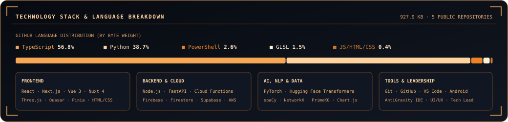

<!--
  HUD-OS // MARK VII GITHUB PROFILE README — @Tin-axle (Justine Smith C. Rendaje)
  Foundation: GitSkins (https://www.gitskins.com/) + Custom #ed8326 Space HUD Animated SVGs
  Deployment: Zero hosting required — upload README.md + assets/ directly to Tin-axle/Tin-axle
-->

<!-- ═══════════════════ 1. HOLOGRAPHIC HUD PROFILE HEADER ═══════════════════ -->

 

  

<!-- ═══════════════════ ABOUT ME ═══════════════════ -->

## 🛰️ `01 // MISSION DOSSIER — ABOUT ME`

> **Justine Smith C. Rendaje** (`@Tin-axle`) — Computer Science student at the **University of San Agustin** (*BSCS, Aug 2023 – Jun 2027 Expected*) based in **Iloilo City, Philippines**.

- 🚀 **Full-Stack Systems & Technical Leadership** — Hands-on experience leading the architecture, development, and deployment of scalable web platforms, cloud-backed services, and offline-resilient applications.
- 🧭 **Cross-Functional Execution** — Experienced coordinating engineering teams across university-wide deployments (onboarding **8,183 users** in a 3–5-day sprint), technical student organizations, and regional hackathons.
- 🔬 **Engineering Focus** — Full-stack web engineering (`TypeScript`, `React/Next.js`, `Vue/Nuxt`, `Node.js`, `Firebase/Supabase`), applied AI & knowledge graphs (`Python`, `PyTorch`, `Hugging Face`, `FastAPI`), and real-time interactive/GPU graphics (`Three.js`, `Phaser`, `GLSL`).
- 📡 **Current Leadership** — Technology Department Lead (and former CEO) at the **Augustinian Developers Society**, Vice President of Finance at the **Institute of Computer Science**, and Technology Officer at **Holotech**.

  

<!-- ═══════════════════ 2. 3D CONTRIBUTION CITY ═══════════════════ -->

## 🌆 `02 // CONTRIBUTION METROPOLIS — 3D ISOMETRIC SKYLINE`

Each isometric tower represents a single day from `@Tin-axle`'s verified GitHub contribution calendar (**527 contributions** across **78 active days**, peak **32 contributions on July 25, 2026**, and a **14-day peak streak**). Tower elevation and warm-to-pale orange illumination scale directly with daily activity intensity.

  

  

<!-- ═══════════════════ 3 & 4. TECH SOLAR SYSTEM & REPO MOONS ═══════════════════ -->

## 🪐 `03 // TECHNOLOGY SOLAR SYSTEM & ORBITING REPOSITORY MOONS`

Languages and core engineering stacks orbit `@Tin-axle` as planets sized from verified GitHub repository byte statistics (**948.9 KB** across public repositories) alongside verified resume ecosystems. Repositories orbit their primary technology planet as luminous moons.

  

<b>📡 Open Orbital Directory — Clickable Repository Moons by Host Planet</b>

 

| Host Planet | GitHub Byte Share | Orbiting Repository Moons | Focus & Primary Stack |
| :--- | :---: | :--- | :--- |
| 🟠 **TypeScript** | `56.9%` (`540.0 KB`) | [**Ball-Bearing**](https://github.com/Tin-axle/Ball-Bearing) · [**Prototype**](https://github.com/Tin-axle/Prototype) · *USA Attendance System*\* | Multiplayer physics arena (Colyseus + Matter.js + React + Phaser 3), Next.js OCR tester, Nuxt 4 university platform |
| 🟡 **Python** | `38.8%` (`368.1 KB`) | [**KoiPond**](https://github.com/Tin-axle/KoiPond) · [**arithmatron**](https://github.com/Tin-axle/arithmatron) · [**ScreenSaver**](https://github.com/Tin-axle/ScreenSaver) · *Medicalexa*\* | GPU-accelerated koi screensaver, GameOn numerical combat typing game, offline clinical KG question generator |
| 🟧 **PowerShell** | `2.6%` (`24.3 KB`) | [**KoiPond**](https://github.com/Tin-axle/KoiPond) *(build & packaging scripts)* | Automated Windows `.scr` packaging & deployment scripts |
| ✨ **GLSL** | `1.5%` (`14.5 KB`) | [**KoiPond**](https://github.com/Tin-axle/KoiPond) *(water & caustics shaders)* | Real-time GPU water refraction, ripples & underwater caustics |
| 🌕 **JavaScript & Web** | `0.4%` + Collab | [**Quarto**](https://github.com/Cocoasaur/Quarto) *(Collab · Project Manager & UI/UX)* | Dual-portal cloud boarding house management system (Firebase, Cloud Functions, Chart.js) |
| 🛰️ **Java & Cloud Core** | *Resume Verified* | `Java` · `React` · `Vue` · `Next.js` · `Nuxt.js` · `Firebase` · `Supabase` · `AWS` | Verified academic, hackathon, and organizational production stacks |

* Solid moons represent public GitHub repositories; ringed moons (`*`) represent verified academic/production flagship systems from resume.

  

<!-- ═══════════════════ FEATURED PROJECTS ═══════════════════ -->

## 🚀 `04 // FEATURED MISSIONS & REPOSITORIES`

### Flagship Systems *(Verified Resume Projects)*

<table>
  <tr>
    <td width="50%" valign="top">
      <h3>🏛️ USA Attendance System</h3>
      <b>University of San Agustin</b> · Project Lead
      
Centralized university event management &amp; QR-based attendance platform replacing manual paper workflows with role-based access, real-time dashboards, audit logs, automated certificate generation, and verification. Led a <b>3–5-day sprint onboarding 8,183 users</b> with offline-capable caching and automated batch email fallbacks.

      <code>Vue 3</code> <code>Nuxt 4</code> <code>TypeScript</code> <code>Quasar UI</code> <code>Pinia</code> <code>Firebase</code> <code>Node.js</code> <code>Sharp</code> <code>Nodemailer</code> <code>SheetJS</code>
    </td>
    <td width="50%" valign="top">
      <h3>🧬 Medicalexa — Medical QG System</h3>
      <b>University of San Agustin</b> · Project Lead
      
Offline-first medical question generation system driven by a template-based architecture eliminating cloud dependencies. Designed and integrated a clinical reasoning knowledge graph (<b>PrimeKG / NetworkX</b>) to map medical entities and relationships, validated via evaluations with medical professionals and general users.

      <code>React 19</code> <code>TypeScript</code> <code>Vite</code> <code>Tailwind CSS</code> <code>Python</code> <code>PyTorch</code> <code>spaCy/scispaCy</code> <code>NetworkX</code> <code>PrimeKG</code> <code>FastAPI</code>
    </td>
  </tr>
  <tr>
    <td width="50%" valign="top">
      <h3>🏠 <a href="https://github.com/Cocoasaur/Quarto">Quarto — Boarding House Management</a></h3>
      <b>University of San Agustin</b> · Project Manager &amp; UI/UX Designer
      
Led a 4-person engineering team building a cloud-based dual-portal (admin &amp; tenant) platform with room occupancy tracking, payment verification, financial reports, maintenance requests, serverless Firebase Cloud Functions, automated email notifications, and offline-first caching.

      <code>HTML5</code> <code>CSS3</code> <code>JavaScript</code> <code>Node.js</code> <code>Firebase</code> <code>Firestore</code> <code>Cloud Functions</code> <code>Chart.js</code> <code>Nodemailer</code>
    </td>
    <td width="50%" valign="top">
      <h3>⚙️ <a href="https://github.com/Tin-axle/Ball-Bearing">Ball-Bearing — Physics Arena</a></h3>
      <b>@Tin-axle Public Repo</b> · TypeScript (99.5%)
      
Browser-based, physics-driven multiplayer arena fighting game engineered as a <code>pnpm</code> monorepo combining a server-authoritative <b>Colyseus + Matter.js</b> combat engine with a <b>React + Phaser 3</b> frontend and Docker/Fly.io deployment setup.

      <code>TypeScript</code> <code>Colyseus</code> <code>Matter.js</code> <code>React</code> <code>Phaser 3</code> <code>pnpm</code> <code>Dockerfile</code>
    </td>
  </tr>
</table>

### Additional Public GitHub Repositories (`@Tin-axle`)

| Repository | Primary Tech | Description |
| :--- | :---: | :--- |
| [**KoiPond**](https://github.com/Tin-axle/KoiPond) | `Python` · `GLSL` · `PowerShell` | Autonomous Windows screensaver (`.scr`) with illustrated koi artwork, articulated spine-mesh swimming animation, GPU water refraction, ripples, and underwater caustics. |
| [**arithmatron**](https://github.com/Tin-axle/arithmatron) | `Python` | *ArithMetron: A Game of Numerical Combat* — mathematics-based typing game conceptualized and led for the **GameOn 2025 Hackathon** (*Top 15 Semi-Finalist*). |
| [**Prototype**](https://github.com/Tin-axle/Prototype) | `TypeScript` · `Next.js` | `next-ocr-tester` — Next.js + React OCR experimentation workbench integrating Google Cloud Vision, Tesseract.js, and PDF.js. |
| [**ScreenSaver**](https://github.com/Tin-axle/ScreenSaver) | `Python` | Lightweight Python desktop screensaver utility with audio feedback. |

  

<!-- ═══════════════════ TECHNOLOGY STACK ═══════════════════ -->

## ⚡ `05 // TECHNOLOGY STACK & ENGINEERING TELEMETRY`

  

**Languages**  

**Frontend & 3D**  

**Backend, Cloud & AI/ML**  

**Development Tools**  

  

<!-- ═══════════════════ LIVE GITHUB STATISTICS (GITSKINS) ═══════════════════ -->

## 📊 `06 // LIVE GITHUB TELEMETRY — POWERED BY GITSKINS`

Real-time animated panels streamed directly from **GitSkins** (`gitskins.com`) — updating automatically as new commits and repositories ship on `@Tin-axle`.

  
    
  

  

<!-- ═══════════════════ LEADERSHIP & ORGANIZATIONS ═══════════════════ -->

## 🧭 `07 // COMMAND & ORGANIZATIONAL LEADERSHIP`

| Role | Organization | Term | Impact & Scope |
| :--- | :--- | :---: | :--- |
| **Technology Department Lead** | Augustinian Developers Society | `2026 – 2027` | Directing organizational engineering projects and digital solutions for partner organizations and businesses. |
| **Chief Executive Officer** | Augustinian Developers Society | `2025 – 2026` | Led organizational operations, coordinated departmental activities, and oversaw projects, events, and outreach. |
| **Vice President of Finance** | Institute of Computer Science | `2026 – 2027` | Managed organizational finances, monitored income and expenses, and maintained financial records and reports. |
| **Vice Chairperson of Internal Affairs** | Institute of Computer Science | `2025 – 2026` | Managed internal concerns, mediated student conflicts, and coordinated safe, organized student initiatives. |
| **Technology Officer** | Holotech | `2026 – 2027` | Provided technical guidance, developed organizational systems, and advised organizational planning. |
| **Documentations (Creatives Dept.)** | Holotech | `2025 – 2026` | Documented organizational events and community activities through photography. |
| **Computer Science Liaison** | Holotech | `2024 – 2025` | Disseminated academic announcements and supported lower-year Computer Science students. |
| **Documentation Officer / Junior Developer** | Google Developer Student Club | `2024 – 2025` | Contributed to organizational documentation and technical development initiatives. |

  

<!-- ═══════════════════ ACHIEVEMENTS & CERTIFICATIONS ═══════════════════ -->

## 🏆 `08 // ACHIEVEMENTS, HACKATHONS & CERTIFICATIONS`

<table>
  <tr>
    <td width="55%" valign="top">
      <h3>🥇 Awards &amp; Hackathons</h3>
      <ul>
        <li><b>3rd Place (Back-End Developer)</b> — <i>Next Gen Regional Hackathon</i> Philippine Collegiate Championship, CCE Play &amp; Converge · 2026 — Competed against Top 5 finalist teams in Manila over a three-day hackathon.</li>
        <li><b>Top 10 Finalist (Conceptor, Back-End Developer &amp; Coach)</b> — <i>AIFest Regional AI Hackathon</i> AIFest · 2025 — Architected and led backend for a satellite-imagery urban heat mapping platform; coached team to Top 10 finish.</li>
        <li><b>Top 15 Semi-Finalist (Project Manager)</b> — <i>GameOn Game Development Hackathon</i> GameOn · 2025 — Conceptualized and led initial development of <a href="https://github.com/Tin-axle/arithmatron">Arithmetron</a>, a mathematics-based typing game.</li>
        <li><b>1st Place — Academic Excellence</b> — <i>Augustinian Passion Projects (APPs)</i> University of San Agustin · 2024 — Represented Google Developer Student Club in the Academic Excellence category.</li>
      </ul>
    </td>
    <td width="45%" valign="top">
      <h3>📜 Verified Certifications</h3>
      <ul>
        <li><b>Foundations of Artificial Intelligence</b> IBM SkillsBuild · November 2026</li>
        <li><b>AWS Cloud Practitioner Essentials</b> AWS Skill Builder · November 2026</li>
        <li><b>Introduction to Data Science</b> Cisco Networking Academy · September 2026</li>
        <li><b>Introduction to Cybersecurity</b> Cisco Networking Academy · September 2026</li>
        <li><b>Networking Basics</b> Cisco Networking Academy · September 2026</li>
        <li><b>Python Essentials 1</b> Cisco Networking Academy · August 2026</li>
      </ul>
    </td>
  </tr>
</table>

  

<!-- ═══════════════════ CONTACT INFORMATION ═══════════════════ -->

## 📡 `09 // COMMUNICATION UPLINK`

  

 

Built on <a href="https://www.gitskins.com/">GitSkins</a> + Custom <code>#ed8326</code> Space HUD Animated SVGs · Iloilo City, Philippines

